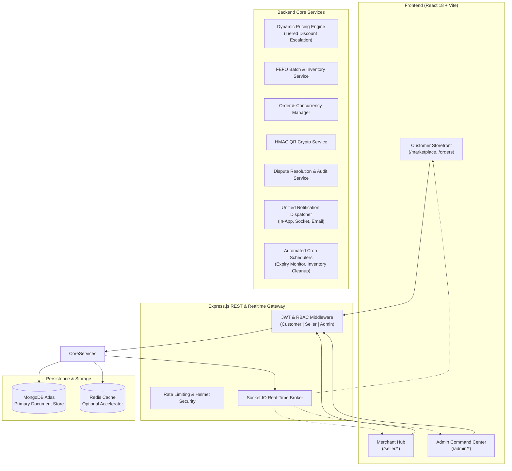

# NearExpiry ⏳ — Dynamic Hyperlocal Near-Expiry Food Rescue Marketplace

[](#)
[](https://nodejs.org)
[](https://expressjs.com/)
[](https://react.dev/)
[](https://vitejs.dev/)
[](https://www.mongodb.com/)
[](https://tailwindcss.com/)

> **"Eat Fresh, Save Big, Waste Nothing."**  
> NearExpiry connects local neighborhood supermarkets with smart shoppers, allowing retailers to monetize near-expiry surplus stock while consumers rescue genuine goods at dynamic, automated discounts before expiration.

---

## 📌 Table of Contents

- [Overview](#-overview)
- [Key Features by Role](#-key-features-by-role)
  - [🛒 Customer Experience](#-customer-experience)
  - [🏪 Merchant Hub (Seller)](#-merchant-hub-seller)
  - [🛡️ Admin Command Center](#️-admin-command-center)
- [System Architecture](#-system-architecture)
- [Tech Stack](#-tech-stack)
- [Project Directory Structure](#-project-directory-structure)
- [Getting Started](#-getting-started)
  - [Prerequisites](#prerequisites)
  - [Environment Variables](#environment-variables)
  - [Backend Setup](#backend-setup)
  - [Frontend Setup](#frontend-setup)
- [Testing](#-testing)
- [Core Domain Innovations](#-core-domain-innovations)
  - [1. FEFO Inventory & Dynamic Pricing Algorithm](#1-fefo-inventory--dynamic-pricing-algorithm)
  - [2. Cryptographic QR Verification for Counter Pickups](#2-cryptographic-qr-verification-for-counter-pickups)
  - [3. Tri-Party Dispute & Complaint Resolution Engine](#3-tri-party-dispute--complaint-resolution-engine)
  - [4. Multi-Channel Notification Dispatcher](#4-multi-channel-notification-dispatcher)
- [Deployment](#-deployment)
- [Contributing & License](#-contributing--license)

---

## 🌟 Overview

Globally, tons of edible food and short-dated daily essentials are discarded daily simply because they reach retail sell-by windows. Traditional supermarket inventory systems lack real-time consumer-facing markdown automation.

**NearExpiry** solves this through:
1. **Dynamic FEFO Allocation**: Prioritizing items nearing expiry for immediate clearance.
2. **Dynamic Pricing Escalation**: Algorithmic discounts that scale up as expiration dates draw near (e.g. 15% off at 15 days, 40% at 7 days, up to 75% in critical rescue windows).
3. **Hyperlocal Geofenced Fulfillment**: Instant pickup from local neighborhood branches or express local delivery.
4. **Platform Governance & Safe Dispute Resolution**: Multi-party messaging, automated inventory restocking on dispute closures, and administrative enforcement.

---

## 🚀 Key Features by Role

### 🛒 Customer Experience
- **Hyperlocal Discovery**: Geolocation-aware marketplace with radius filtering, category search, and real-time stock availability.
- **Expiry Transparency**: Shelf-life countdown tags, batch expiration dates displayed upfront before purchase.
- **Smart Cart & Reservations**: Automatic inventory locks during checkout to prevent concurrency races.
- **Secure QR Counter Pickups**: Cryptographic, time-limited QR codes scanned at merchant counters for instant verification.
- **Direct Merchant Dispute Desk**: Raise order complaints (damaged items, wrong item, delivery delays) and chat directly with the merchant to reach a resolution.
- **Wishlist & Price Alerts**: Automated notifications when watched items drop in price or are restocked.

### 🏪 Merchant Hub (Seller)
- **Store & Branch Management**: Support for primary and secondary store branches with geolocation and operating hours.
- **FEFO Batch Inventory**: Register inventory lots with batch numbers, manufacturing dates, and expiration dates.
- **Expiry Radar & Early Warning**: Automated alerts when batches enter approaching (8–15 days) and critical (&le; 7 days) expiry windows.
- **Integrated QR Scanner**: In-browser camera QR code reader (`html5-qrcode`) and manual fallback token input for rapid fulfillment.
- **Customer Dispute Management**: View order complaints, exchange real-time messages with customers, communicate privately with platform admins, and record official resolutions.
- **Invoices & Bill Receipts**: Itemized, GST-compliant bill generation and digital receipts.

### 🛡️ Admin Command Center
- **Merchant Onboarding & Verification**: Seller verification dossier inspecting legal credentials (PAN, GSTIN, FSSAI license) with one-click approval, rejection, or demo sandbox activation.
- **Store Suspension & Governance**: Server-side store deactivation and suspension enforcement with audit tracking for non-compliant merchants.
- **Support & Disputes Oversight**: Full, read-only chronological audit view of every customer-merchant dispute, including customer replies, seller actions, and private admin directives.
- **Transaction Exception Stream**: Real-time monitor of cancelled orders and payment failures providing audit trails and refund tracking.
- **Dynamic Pricing Rule Control**: Configurable discount thresholds, critical window cutoffs, and platform parameters.
- **Real-Time Notification Hub**: Date-clustered in-app notification center with instant deep-linking to dispute dossiers and seller onboarding applications.

---

## 🏗️ System Architecture



---

## 💻 Tech Stack

| Layer | Technologies |
| :--- | :--- |
| **Frontend** | React 18, Vite 5, React Router v6, Tailwind CSS, Lucide React, Recharts, React Hook Form, HTML5-QRCode |
| **Backend** | Node.js, Express.js (ES Modules), Mongoose, Zod Validation, Socket.IO, JWT, Bcrypt, Helmet |
| **Database** | MongoDB (with 2dsphere Geospatial Indexes & Multi-Tenant Collections), Redis (Optional) |
| **Scheduled Tasks** | `node-cron` automated batch status updates and dynamic discount recalculation |
| **Communications** | Socket.IO WebSockets, Nodemailer SMTP transport |
| **Testing** | Node.js native test runner (`node:test`, `node:assert`), Supertest |

---

## 📁 Project Directory Structure

```text
NearExpiry/
├── backend/
│   ├── src/
│   │   ├── config/             # DB, Socket.IO, Redis configuration
│   │   ├── constants/          # Role, status, and socket event enums
│   │   ├── controllers/        # Express HTTP request controllers
│   │   ├── middleware/         # Auth, RBAC, error handler, rate limiters
│   │   ├── models/             # Mongoose schemas (User, Store, Product, Batch, Order, Complaint, Notification)
│   │   ├── routes/             # REST API endpoint routers (/api/v1/...)
│   │   ├── services/           # Core business logic services
│   │   │   ├── notification/   # Multi-channel dispatcher & email transport
│   │   │   ├── admin.service.js
│   │   │   ├── auth.service.js
│   │   │   ├── complaint.service.js
│   │   │   ├── dynamicPricing.service.js
│   │   │   ├── order.service.js
│   │   │   └── ...
│   │   ├── utils/              # JWT, QR crypto, API response helpers
│   │   ├── validators/         # Zod schema request validation
│   │   ├── app.js              # Express app setup and middleware pipeline
│   │   └── server.js           # HTTP server and WebSocket bootstrap
│   └── tests/                  # Integration and workflow test suites
│
├── frontend/
│   ├── public/                 # Favicons and static assets
│   ├── src/
│   │   ├── components/         # Reusable UI components
│   │   │   ├── admin/          # Admin drawers, metric badges, filter bars
│   │   │   ├── common/         # Modals, NotificationCenter, Navbar, Footer
│   │   │   ├── home/           # Hero banners, value proposition sections
│   │   │   └── seller/         # MerchantStatCard, QR scanner modal, receipt view
│   │   ├── context/            # Auth, Socket, Cart, and Wishlist React Contexts
│   │   ├── layouts/            # PublicLayout, SellerLayout, AdminLayout
│   │   ├── pages/
│   │   │   ├── admin/          # Admin Dashboard, Sellers, Orders, Support & Disputes
│   │   │   ├── public/         # Landing, Marketplace, Cart, Checkout, AboutUs
│   │   │   └── seller/         # Seller Dashboard, Products, Batches, Orders, Complaints
│   │   ├── services/           # Axios API consumer clients
│   │   ├── utils/              # Notification grouping, currency formatters
│   │   ├── App.jsx             # React Router routing configuration
│   │   └── main.jsx            # React root mount
│   ├── index.html
│   ├── tailwind.config.js
│   └── vite.config.js
│
├── .env.example                # Sample environment configuration template
└── README.md
```

---

## 🛠️ Getting Started

### Prerequisites
- **Node.js** >= 18.0.0
- **npm** >= 9.0.0
- **MongoDB** instance (Local or MongoDB Atlas connection string)
- *(Optional)* **Redis** server for caching

### Environment Variables

Copy `.env.example` in the backend directory or root:

```bash
# Server & Port
PORT=5000
NODE_ENV=development
API_PREFIX=/api/v1

# Database
MONGODB_URI=mongodb+srv://<user>:<password>@cluster.mongodb.net/nearexpiry?retryWrites=true&w=majority

# Client URLs (CORS)
CLIENT_URL=http://localhost:5173
CORS_ORIGIN=http://localhost:5173

# Authentication & Security
JWT_SECRET=super_secret_jwt_key_at_least_32_characters_long
JWT_EXPIRES_IN=7d
QR_SIGNING_SECRET=secure_cryptographic_qr_signing_token_key

# Optional Email / SMTP
SMTP_HOST=smtp.gmail.com
SMTP_PORT=587
SMTP_USER=your_email@gmail.com
SMTP_PASS=your_app_password
SMTP_FROM="NearExpiry <no-reply@nearexpiry.app>"
```

### Backend Setup

```bash
# 1. Navigate to backend directory
cd backend

# 2. Install dependencies
npm install

# 3. Start development server with nodemon
npm run dev

# Backend will run on http://localhost:5000
```

### Frontend Setup

```bash
# 1. Navigate to frontend directory
cd frontend

# 2. Install dependencies
npm install

# 3. Start development server with Vite
npm run dev

# Frontend will run on http://localhost:5173
```

---

## 🧪 Testing

The repository contains end-to-end integration and workflow test suites built on the Node.js native test runner:

```bash
# Run seller verification, RBAC, and onboarding suite
node --test backend/tests/sellerVerificationWorkflow.test.js

# Run customer-seller dispute resolution & admin oversight suite
node --test backend/tests/complaintResolutionWorkflow.test.js

# Run full backend test suite
npm --prefix backend test

# Run frontend production build verification
npm --prefix frontend run build
```

---

## 🔬 Core Domain Innovations

### 1. FEFO Inventory & Dynamic Pricing Algorithm
NearExpiry implements strict First-Expired, First-Out (FEFO) batch consumption. Batches entering designated threshold windows are automatically re-priced using continuous dynamic depreciation curves:
- **Normal Shelf Life (> 15 Days)**: Standard retail pricing.
- **Approaching Expiry (8–15 Days)**: Dynamic discount tier (e.g. 25% – 40% OFF).
- **Critical Expiry Window (≤ 7 Days)**: Emergency clearance pricing (up to 75% OFF).
- **Expired (< 0 Days)**: Automatic operational quarantine preventing consumer checkout.

### 2. Cryptographic QR Verification for Counter Pickups
Upon order confirmation, the customer receives a secure, HMAC-signed pickup payload. At the merchant counter:
1. The seller scans the QR code directly with the integrated browser camera.
2. The server verifies signature authenticity, store ownership, and branch matching.
3. Upon validation, the order status transitions to `DELIVERED`, generating a bill receipt and settling inventory reservations.

### 3. Tri-Party Dispute & Complaint Resolution Engine
A role-governed dispute workflow:
- **Customer & Seller**: Direct messaging channel to negotiate replacements, missing items, or refunds.
- **Admin Oversight**: Real-time read-only visibility into the entire conversation history, timeline events, and transaction exceptions.
- **Private Admin Directive Channel**: Platform admins can issue warnings/instructions directly to the seller that are completely hidden from the customer.
- **Accountability**: Administrative capability to temporarily suspend or deactivate offending stores directly from the dispute dossier while preserving order history.

### 4. Multi-Channel Notification Dispatcher
All key business events (order placement, approaching expiry alerts, new seller signups, dispute replies) are routed through a pluggable multi-channel dispatcher:
- **Persistent MongoDB Inbox**: Date-clustered in-app notification center.
- **Socket.IO Real-Time Stream**: Live UI updates without page refreshes.
- **Email Channel**: SMTP transaction notifications with custom action links.

---

## 🚀 Deployment

- **Frontend**: Optimized for single-command deployment on **Vercel** (`vite build`). Configured with SPA rewrite rules in `vercel.json`.
- **Backend**: Container-ready for **Docker**, **Render**, **Railway**, or **AWS EC2** using Node.js clustering and MongoDB Atlas.

---

## 📄 License & Contributing

NearExpiry is open-source software built for educational, community, and commercial sustainable retail research. Contributions, feature suggestions, and bug reports are welcome via Pull Requests.

```text
Designed with ❤️ for zero food waste and greener local communities.
```

